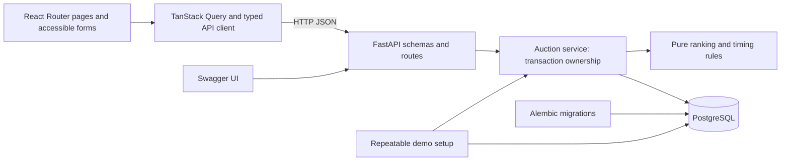

# High-level design and database schema

A React/TypeScript/Vite client calls a synchronous FastAPI application backed
by PostgreSQL.

`backend/app/schemas.py` validates inputs and serializes responses;
`domain.py` handles ranking, timing and status independently of persistence.
`service.py` owns transactions, `models.py` maps entities and `main.py` supplies
HTTP routes, safe errors and CORS. Alembic and demo setup share backend settings.
`backend/tests/database_guard.py` verifies the dedicated test target before
migrations or test cleanup.

## Client data flow

React Router provides listing `/`, creation `/rfqs/new` and detail `/rfqs/:id`.
`frontend/src/api` holds contracts, fetch handling and query hooks; `domain`
holds money/time functions; `pages` composes screens; `components` provides
forms, tables and error/status UI. Shared tokens are in `styles.css`.

GET queries cache listings, details and suppliers. Active auctions poll every
five seconds; focus and boundary timers also refetch. Successful POSTs refresh
saved data without optimistic rank/close changes. Local form state survives
refetches and errors; failed refreshes retain previously loaded data.

Money uses BigInt cents in the client and decimal strings over HTTP.
Local times convert explicitly to ISO UTC; nonexistent DST times are rejected,
and repeated times use the browser's earlier offset. Calendar dates remain
strings. Countdown estimates use server time plus monotonic elapsed browser time;
they do not authorize acceptance.

## Schema

| Table | Fields and invariants |
| --- | --- |
| `suppliers` | Stable integer PK; unique name |
| `rfqs` | BIGSERIAL PK; unique reference; name; enabled flag; start/initial/current/forced close TIMESTAMPTZ; pickup DATE; positive X/Y; trigger; created timestamp |
| `bids` | BIGSERIAL PK/sequence; RFQ/supplier FKs; carrier; freight/origin/destination/total NUMERIC(18,2); positive transit hours; validity DATE; acceptance TIMESTAMPTZ |
| `activities` | BIGSERIAL PK; RFQ/bid FKs, including matching RFQ/bid composite FK; kind; extension reason; old/new close; occurrence TIMESTAMPTZ |

RFQ checks enforce ordered times, enabled scope, valid trigger, positive X/Y and
bounded current close. A database trigger requires current close to start at
initial close, prevents decreases and keeps configuration immutable.
Bid checks enforce nonnegative charges, an exact positive finite total, transit,
validity and foreign keys. API validation also limits monetary precision and
requires validity through service. Direct SQL can coerce NUMERIC scale;
application writers must use the validated service path.

Each accepted bid has one `bid_accepted` event and at most one `extended` event,
protected by unique `(bid_id, kind)`. Extensions require a recognized reason
and advancing close times. Indexes cover bids `(rfq_id, supplier_id, id)` and
activity `(rfq_id, id)`. Foreign keys have no cascading deletes.

## Bid transaction

Sessions use UTC. A bid uses one explicit READ COMMITTED transaction:

1. Lock the RFQ with `SELECT FOR UPDATE`, then sample server UTC.
2. Check timing, supplier, validity and strict improvement; read existing bids.
3. Derive current ranks, insert the bid, derive new ranks and compute any extension.
4. Update current close and insert acceptance/extension activity.
5. Commit everything together; any failure rolls back all writes.

The lock serializes suppliers and rebids per RFQ. A waiting READ COMMITTED
statement sees the committed RFQ version and samples time after its wait.
Bid sequences allocated under the lock give deterministic tie order;
rollback sequence gaps are harmless.

Listing/detail reads use one REPEATABLE READ snapshot so close, ranks, history
and activity describe the same state. Status is derived from server time and
stored close values rather than updated by a scheduled job.

## Auction rules

- Total = freight + origin + destination in INR, using Decimal/NUMERIC arithmetic.
  Requests accept decimal strings or integers, reject fractional JSON numbers
  and booleans, and allow at most two decimal places. Each charge is between
  zero and 999999999999.99; total must be positive. Responses use decimal strings.
- The latest accepted bid per supplier is current. A rebid must strictly lower
  that supplier's previous total. Rank by total, then the current quote's accepted
  sequence; improving into a tie follows the earlier quote at that price.
  Full history is separately sorted by total then sequence.
- Require start < initial close < forced close, with future initial close at
  creation. Start may already have passed. Accept only start <= server now <
  current close and server now < forced close.
- The trigger window is [current close minus X minutes, current close).
  Any-bid qualifies for every accepted bid in it; any-rank compares the full
  supplier-to-rank map; L1 compares leader supplier IDs. New participation
  changes the rank map; empty-to-first changes L1.
- A qualifying bid adds Y once to current close, capped at forced close.
  Later bids use the updated window. No extension event is written at the cap.
- Before start, status is Active with Not started. At current close, status is
  Closed if current close is below forced close, otherwise Force Closed.
  Ordinary Closed stays Closed after its unused forced time passes.
- **Implementation assumption:** pickup/service date is on or after the
  forced-close UTC date. Quote validity covers service and acceptance dates
  inclusively. Both fields are UTC calendar dates.

## Trade-offs

Four tables separate configuration, supplier identity, immutable accepted quotes
and activity. Synchronous sessions and per-RFQ locks keep atomic writes simple;
ranking from full history and unpaginated reads suit a bounded dataset.
Polling avoids push infrastructure; derived status needs no worker.

There is no authentication or backend idempotency. Ambiguous responses require
saved-state inspection before a retry; client recovery cannot guarantee
exactly-once delivery. Setup, demo and verification commands are in
[README](../README.md).
